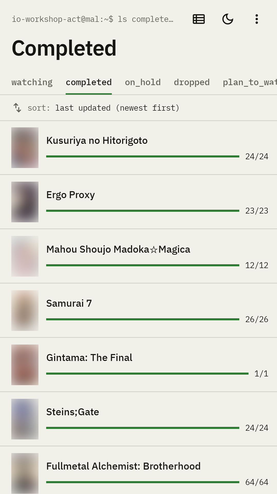
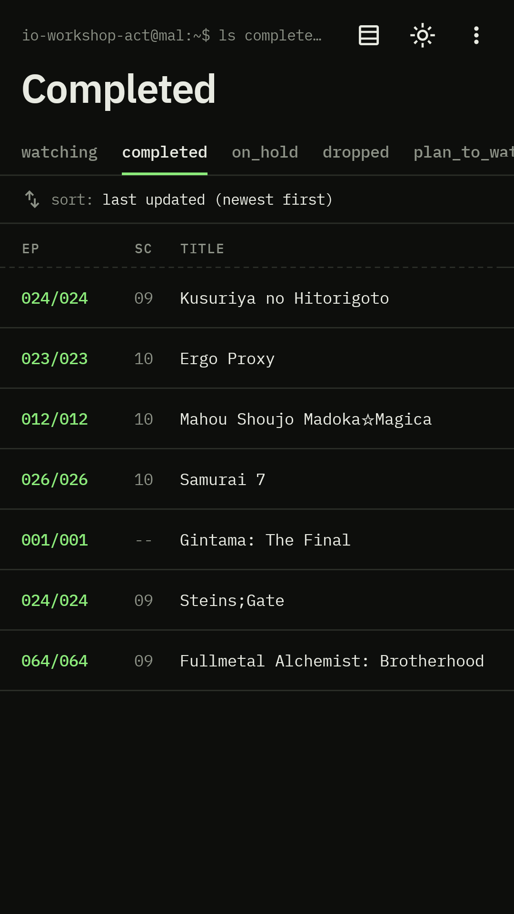
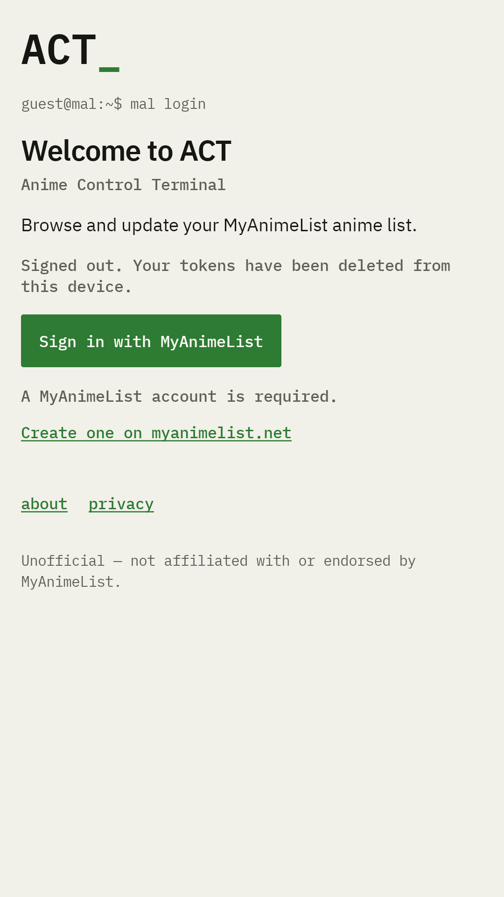

# act

A [MyAnimeList](https://myanimelist.net) client built with Kotlin Multiplatform and Compose Multiplatform.

**Live demo:** [https://act.io-workshop.net](https://act.io-workshop.net)

## Screenshots

<p>
  
  
  
</p>
<p>
  
  
  
</p>

## Features

- **OAuth2 Authentication** — Full OAuth2 authorization code flow with PKCE (`code_challenge_method=plain`). Each
  platform captures the redirect differently (loopback on desktop, popup on web, custom-scheme intent on Android). A
  paste-the-code fallback covers edge cases across all platforms.
- **Anime List** — Paginated, filterable, sortable list of your MAL anime entries with multiple layout options
  (grid/list).
- **Anime Page** — Detail view for individual anime with related entries, list-edit functionality (score, status,
  episodes watched), and patch-log tracking.
- **Session Management** — Token storage with automatic refresh, session diagnostics, and sign-out.
- **Theming** — Light/dark/system theme preference persisted per-device.

## Tech Stack

- **Language**: Kotlin (Kotlin Multiplatform)
- **UI**: Compose Multiplatform (shared UI across Android, Desktop, and Web)
- **Build**: Gradle (Kotlin DSL) with [mise](https://mise.jdx.dev) for tool runtime and task orchestration
- **Networking**: Ktor HttpClient with custom auth-token refresh plugin
- **Serialization**: Kotlinx Serialization
- **Async**: Kotlin Coroutines (flow-based reactive state)
- **DI**: Koin (`:core` is intentionally Koin-free)
- **Server**: Ktor server (JVM) — MAL relay for the web target
- **Image Loading**: Coil (Compose Multiplatform)

## Platform Targets

| Target            | Description                                                       |
|-------------------|-------------------------------------------------------------------|
| **Android**       | Native Android app via Compose Multiplatform                      |
| **Desktop (JVM)** | Desktop app with single-instance lock and loopback OAuth listener |
| **Web (Wasm)**    | Web app compiled to WebAssembly, served via webpack dev server    |

## Project Layout

| Module                               | Purpose                                                                                                                                                                                              |
|--------------------------------------|------------------------------------------------------------------------------------------------------------------------------------------------------------------------------------------------------|
| [`core`](./core/src)                 | Pure KMP business logic — no Compose, no Koin. Contains sign-in flow, session management, anime list, anime page, MAL API client, auth (OAuth2/PKCE), and screen state. Targets: JVM, Wasm, Android. |
| [`app/shared`](./app/shared/src)     | Compose Multiplatform UI + platform abstractions (expect/actual). Contains all screens, navigation, DI setup, theming, and per-platform implementations (auth redirect, key-value store).            |
| [`app/androidApp`](./app/androidApp) | Thin Android entry point                                                                                                                                                                             |
| [`app/desktopApp`](./app/desktopApp) | Thin Desktop entry point (single-instance lock, loopback OAuth listener)                                                                                                                             |
| [`app/webApp`](./app/webApp)         | Thin Web (Wasm) entry point (webpack dev server, `/mal` proxy)                                                                                                                                       |
| [`server`](./server/src/main/kotlin) | Ktor relay server — forwards MAL API calls under `/mal` so the browser can reach MAL without CORS issues. Supports rate limiting, trusted-proxy X-Forwarded-For, body-size caps, and CORS.           |
| [`deploy`](./deploy)                 | Dockerfiles, Caddy config, Docker Compose, Terraform, and deploy scripts                                                                                                                             |

## Architecture

- **Repository pattern**: `AnimeListRepository`, `AnimePageRepository`, `MalSessionRepository` encapsulate business
  logic and API calls.
- **Flow-based reactive state**: All state flows through Kotlin `StateFlow`/`SharedFlow`. The `ScreenState` source
  combines multiple flows into a single UI-driving stream.
- **Expect/actual platform abstraction**: Platform-specific code (auth redirect, storage, HTTP endpoints) is isolated
  via KMP `expect`/`actual`.
- **Dependency Injection**: Koin manages the shared graph (`appModule`) plus a per-target `platformModule`. Core stays
  DI-free.
- **Single authenticated HttpClient**: One `MalSessionRepository` owns token refresh; repositories share it to avoid
  race conditions.
- **`:core` has zero Compose and zero Koin dependencies** — it is pure KMP logic that can be tested independently.
- **Web relay is same-origin** — the relay runs under the same origin as the web app, so CORS is never an issue.

## Setup

Everything runs through [mise](https://mise.jdx.dev); `mise tasks` lists every command.

```bash
mise install                                  # the JDK (Azul Zulu 21) and Terraform
cp .secure.build.env.example .secure.build.env   # then fill in MAL_CLIENT_ID
```

The Client ID comes from an app registered at [myanimelist.net/apiconfig](https://myanimelist.net/apiconfig) with App
Type `other`. Without one the app still builds, runs and tests; Sign-in is disabled.

In an IDE, point the Gradle JDK at the mise install (`mise where java`) — Gradle no longer downloads one.

## Run

```bash
mise run run:desktop        # desktop
mise run run:desktop:hot    # desktop with Compose Hot Reload
mise run run:server         # relay on :18010
mise run run:web            # web on :18020 — needs run:server as well
mise run build:android      # Android debug APK
```

### Ports

| Port  | Service                               |
|-------|---------------------------------------|
| 18010 | `:server` — Ktor MAL relay            |
| 18020 | `:app:webApp` dev server              |
| 18040 | Desktop OAuth callback on `127.0.0.1` |

## Test

```bash
mise run test                                  # everything
mise run test:core                             # :core on every target
mise run test:shared:jvm                       # also test:shared:android, test:shared:web
mise run test:android
mise run test:server
mise run test:one core "*.SignInTest"          # one class or method; suites: core, shared, server, android
mise run build                                 # compile every target and run every test
```

## Deploy

`mise run deploy` — see the Deployment section of [`CLAUDE.md`](./CLAUDE.md), which is also the full reference for
everything above. Needs `docker` (with buildx) and `ssh` on the machine; mise does not manage those.

## More Details

For in-depth documentation on authentication, deployment, build configuration, and development conventions, see [
`CLAUDE.md`](./CLAUDE.md).
