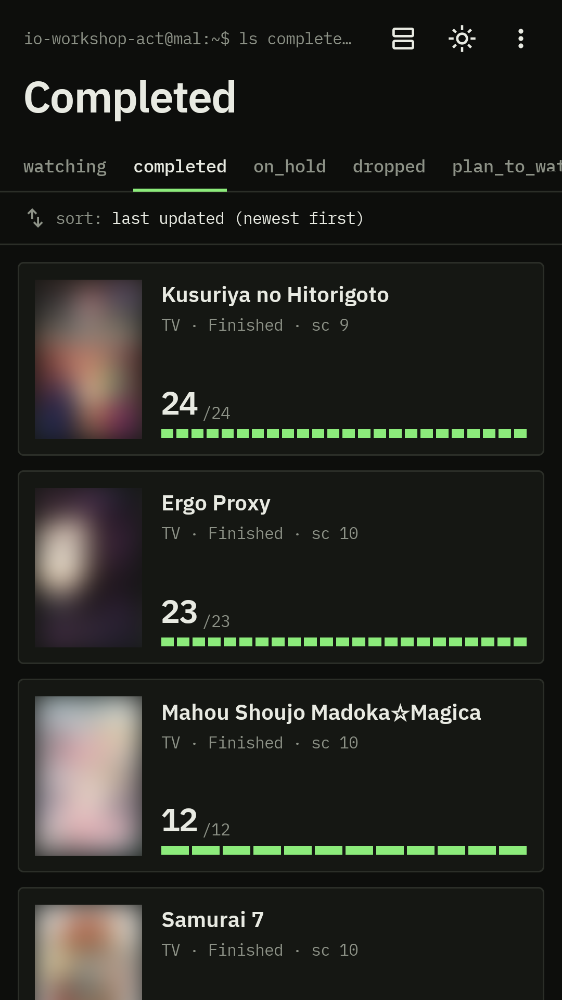
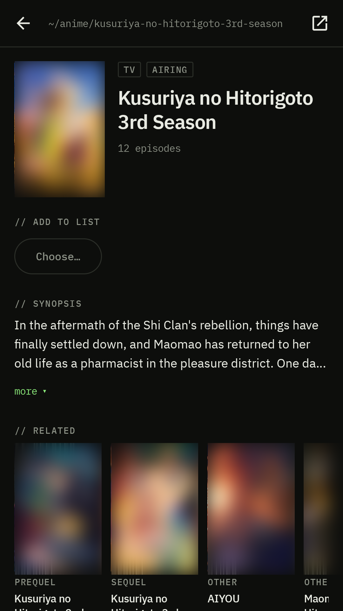
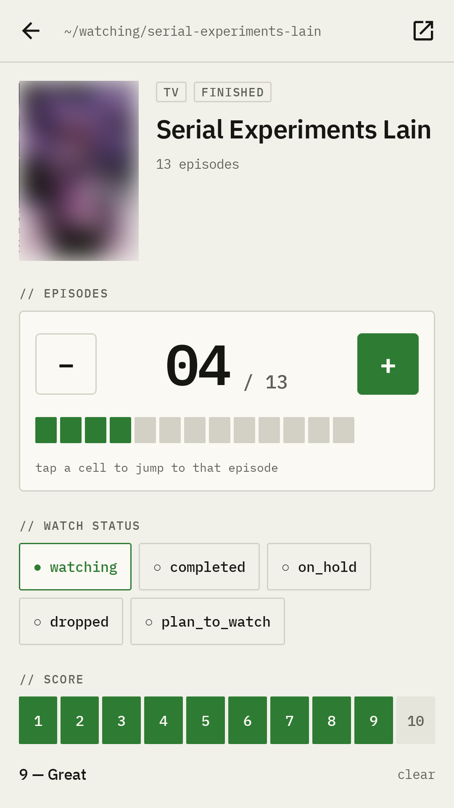

# ACT — Anime Control Terminal

[](https://github.com/MustD/act/releases/latest)
[](https://aur.archlinux.org/packages/io-workshop-act-bin)
[](LICENSE)

A fast, tidy client for your [MyAnimeList](https://myanimelist.net) anime list, on the web, the Linux desktop and
Android. Built with Kotlin Multiplatform and Compose Multiplatform.

<p>
  
  
  
</p>

## Get ACT

| Platform                  | How                                                                                                   |
|---------------------------|-------------------------------------------------------------------------------------------------------|
| **Web**                   | Open **[act.io-workshop.net](https://act.io-workshop.net)** — nothing to install                     |
| **Arch Linux / Manjaro**  | [`io-workshop-act-bin`](https://aur.archlinux.org/packages/io-workshop-act-bin) from the AUR          |
| **Debian / Ubuntu**       | `.deb` from the [latest release](https://github.com/MustD/act/releases/latest)                       |
| **Android**               | Not on Google Play yet — [build from source](#build-from-source)                                     |
| **Windows / macOS**       | No installer published yet — [build from source](#build-from-source)                                 |

### Arch Linux (AUR)

```bash
yay -S io-workshop-act-bin     # or paru, or any AUR helper
io-workshop-act                # or "ACT" in the application menu
```

### Debian / Ubuntu (.deb)

Download `io-workshop-act_<version>_amd64.deb` from the [latest release](https://github.com/MustD/act/releases/latest),
then:

```bash
sudo apt install ./io-workshop-act_*_amd64.deb
```

ACT appears in the application menu; it installs to `/opt/io-workshop-act/`. Remove it with
`sudo apt remove io-workshop-act`. x86-64 only.

### Signing in

Sign in with your MyAnimeList account. MAL only allows OAuth2, so the app sends you to myanimelist.net and your password
is only ever typed there; ACT never sees it. On desktop the sign-in opens in your browser and comes back on
`127.0.0.1:18040`, so that port must be free while you sign in.

## Features

- **Your Anime List** — cards, rows or a table; filter by Watch Status and sort by last updated, score, title or start
  date.
- **Anime Pages** — synopsis, scores, studios, genres and Related Anime, each of which opens its own page.
- **Edit as you go** — Watch Status, episodes watched, score, start and finish dates. Every edit is sent to MAL
  immediately; there is no save button, and a change MAL refuses is rolled back and shown.
- **Light, dark or system theme**, remembered across sessions.
- **Adult covers** are replaced by a placeholder in the Android app.
- **No ads, no analytics, no tracking.** See the [privacy policy](https://act.io-workshop.net/privacy).

## Build from source

Requires [mise](https://mise.jdx.dev). Every command is a mise task; `mise tasks` lists them.

```bash
mise install                                     # the JDK (Azul Zulu 21) and Terraform
cp .secure.build.env.example .secure.build.env   # then fill in MAL_CLIENT_ID
```

`MAL_CLIENT_ID` comes from an app you register at [myanimelist.net/apiconfig](https://myanimelist.net/apiconfig) with
App Type **other**. Without one everything still builds, runs and tests, but Sign-in is disabled.

In an IDE, point the Gradle JDK at the mise install (`mise where java`); Gradle does not download one.

### Run

```bash
mise run run:desktop        # desktop
mise run run:desktop:hot    # desktop with Compose Hot Reload
mise run run:android        # install and launch on the device in ANDROID_TEST_DEVICE_ID
mise run run:server         # MAL relay on :18010
mise run run:web            # web on :18020; needs run:server running too
```

The web app cannot call MAL directly (MAL sends no CORS headers), so it goes through the relay in `:server`, served on
the same origin under `/mal`.

| Port  | Service                                               |
|-------|-------------------------------------------------------|
| 18010 | `:server`, the MAL relay                              |
| 18020 | `:app:webApp` dev server                              |
| 18040 | Desktop OAuth callback on `127.0.0.1`, while signing in |

### Package

```bash
mise run build:android      # debug APK
mise run build:desktop:deb  # Linux .deb (on Linux, needs dpkg-deb)
mise run build:desktop:msi  # Windows .msi (on Windows, unsigned)
mise run build:desktop:dmg  # macOS .dmg (on macOS, unsigned)
```

Installers need a Client ID; without one the packaging task fails rather than produce an app that cannot sign in.

### Test

```bash
mise run test                            # every test on every target
mise run test:core                       # one module; also test:shared:{jvm,android,web}, test:server, test:android
mise run test:one core "*.SignInTest"    # one class or method; suites: core, shared, server, android
mise run build                           # compile every target and run every test
```

## Project layout

| Module                               | Purpose                                                                                       |
|--------------------------------------|-----------------------------------------------------------------------------------------------|
| [`core`](core)                       | Pure Kotlin Multiplatform logic, no Compose and no Koin: sign-in, session, MAL API, Screen State |
| [`app/shared`](app/shared)           | Compose Multiplatform UI and the per-platform pieces (redirect capture, storage)              |
| [`app/androidApp`](app/androidApp)   | Thin Android entry point                                                                      |
| [`app/desktopApp`](app/desktopApp)   | Thin desktop entry point and installer config                                                 |
| [`app/webApp`](app/webApp)           | Thin web (Wasm) entry point and dev server config                                             |
| [`server`](server)                   | Ktor relay that forwards MAL calls under `/mal` for the web app                                |
| [`deploy`](deploy)                   | Docker images, Caddy, Compose, Terraform and scripts for the web deployment                   |
| [`packaging/aur`](packaging/aur)     | PKGBUILD template for the AUR package                                                          |

Stack: Kotlin Multiplatform, Compose Multiplatform, Ktor (client and server), kotlinx.serialization, Coroutines, Koin,
Coil. Targets: Android, JVM desktop, Wasm.

## Documentation

- [`CLAUDE.md`](CLAUDE.md) — the full developer reference: authentication on each platform, configuration, deployment
  and releases.
- [`CONTEXT.md`](CONTEXT.md) — the domain vocabulary.
- [`docs/adr/`](docs/adr) — architecture decision records.

## License

[MIT](LICENSE). ACT is unofficial and not affiliated with or endorsed by MyAnimeList. Anime data is provided by
MyAnimeList.net.
